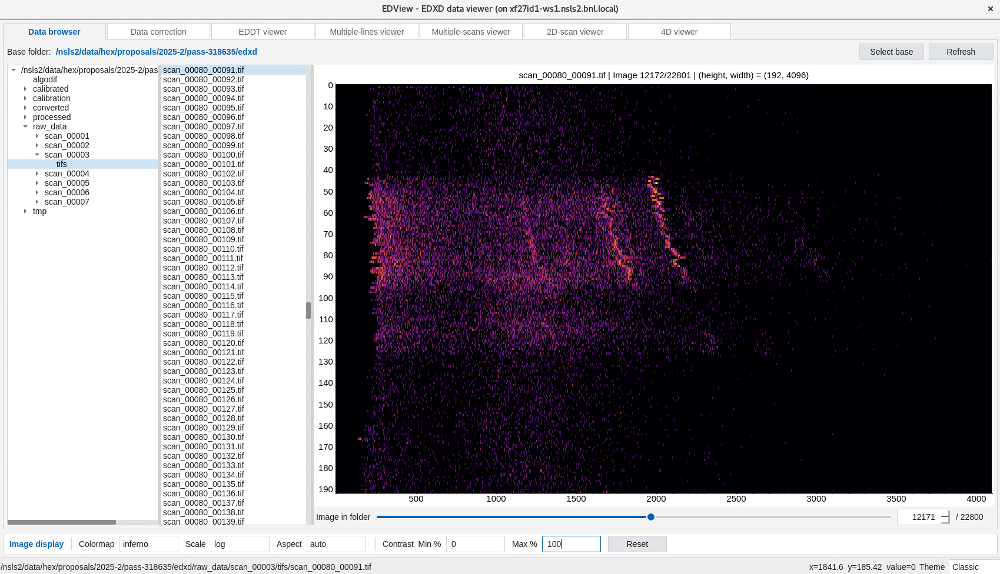
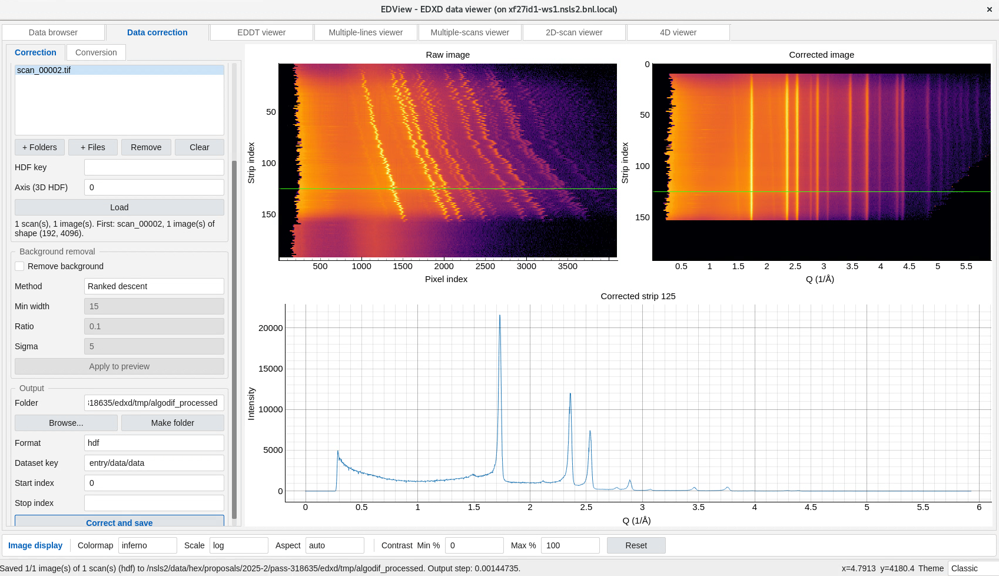
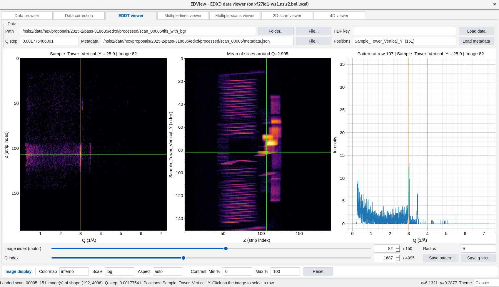
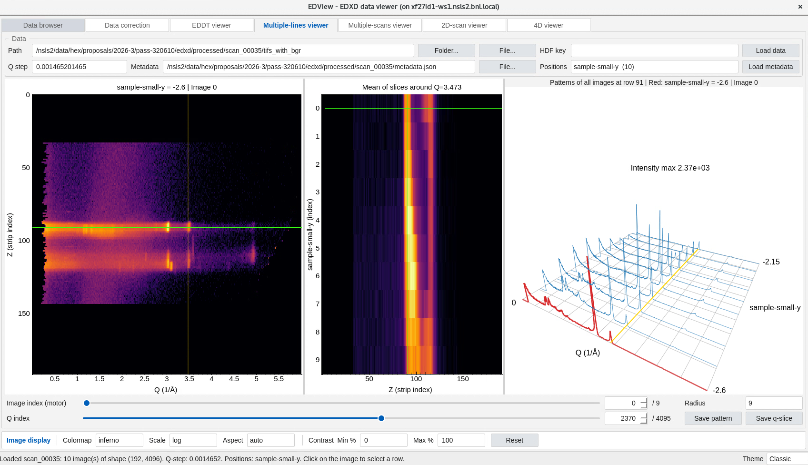
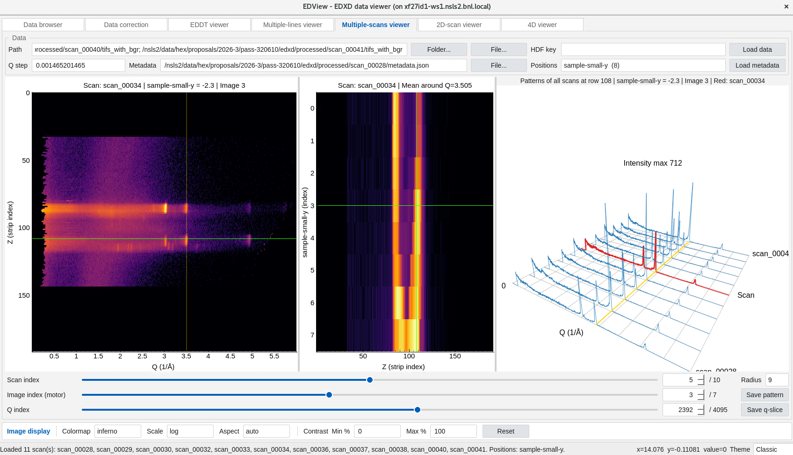
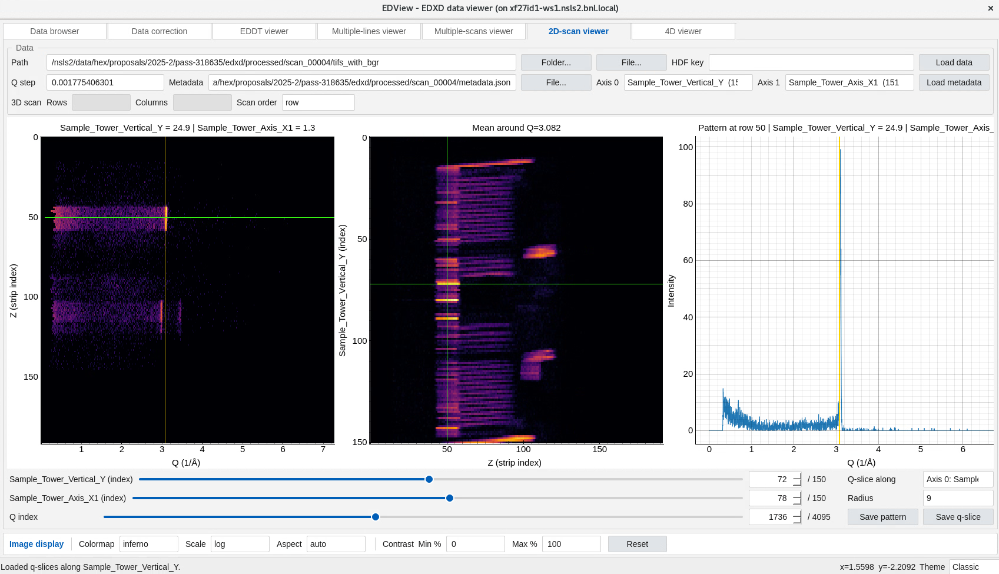
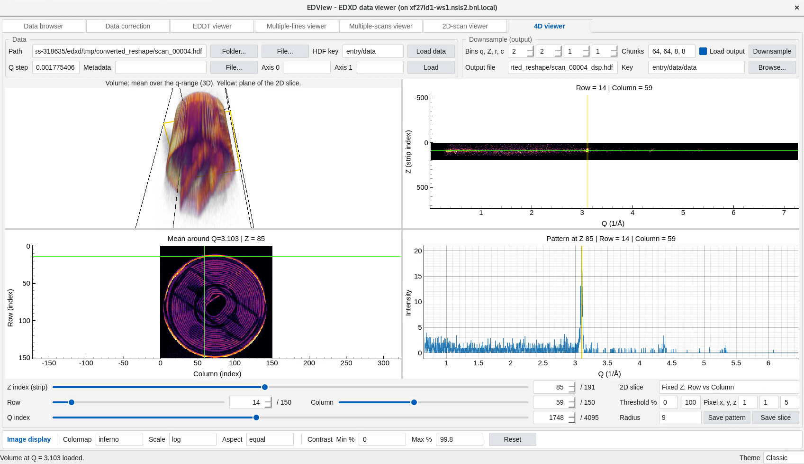

# EDView
#### (**E**)nergy-(**D**)ispersive X-ray diffraction data (**View**)er

GUI software for viewing data of the Energy-Dispersive X-ray Diffraction
Tomography (EDDT) technique, processed by [Algodif](https://github.com/algodif/algodif).
Built on Algodif, PySide6, pyqtgraph, and pyopengl. This unified GUI combines the 
separate GUIs published in the Algodif codebase.

Tabs
====

- **Data browser**: folder tree, file list and preview of images, text/JSON
  files and HDF datasets. Send the selected files or folders to other tab
  with *View in* or *Add to*.

  

- **Data correction**:
  - *Correction*: correct raw scans (a scan folder with a `tifs` sub-folder,
    a folder of tif files, files, an HDF file, or a range of `scan_xxxxx`
    folders) with q or energy calibration coefficients, with optional
    background removal. Output per scan: tif, HDF, or xy/csv (raw or corrected), plus
    `metadata.json` (with the output step), the coefficients and the map of
    the raw pixels.
  
    

  - *Conversion*: tif folder to 3D HDF, 3D HDF to tif folder, tif folder of
    a 2D scan to 4D HDF, tif folder or HDF to xy/csv files.

- **EDDT viewer**: image of a 1D scan, q-slice across the scan, and the
  diffraction pattern of the selected row.

  

- **Multiple-lines viewer**: as above, with the patterns of all images at
  the selected row.

  

- **Multiple-scans viewer**: several 1D scans; patterns of all scans at the
  same image and row.

    

- **2D-scan viewer**: image at a scan position (tif files named
  `..._<row>_<col>.tif`, loaded on demand, a 4D HDF dataset, or a 3D HDF
  dataset with the scan rows, columns and scan order given: row, column,
  snake_row or snake_column), its pattern, and the q-slice along one scan
  axis.

  

- **4D viewer**: a 4D HDF dataset (q, Z, scan rows, scan columns) of a 2D
  scan, read on demand. Shows the volume (mean over a q-range) in 3D, with
  transparency thresholds and real pixel sizes, a 2D slice of the volume
  (fixed row, column or Z), the q-Z image at a scan position, and the
  diffraction pattern at a Z. Large files can be downsampled (mean binning
  along q, Z, rows and columns) to a smaller HDF file, and viewed directly.
  Without PyOpenGL, the 3D view is replaced by a 2D image of the volume.
  
  

The viewers read the q-step and the motor positions from the JSON metadata next 
to the data (e.g. written by the Data correction tab or `process_data.py` of 
Algodif), or from the HDF file. Clicking on the image selects a row and an x-value; 
clicking on the q-slice selects a row and a scan position.

Installation
============

Install [Miniconda, Anaconda or Miniforge](https://docs.conda.io/projects/conda/en/latest/user-guide/install/index.html), then 
open a Linux terminal or the Miniconda/Anaconda PowerShell prompt and use the 
following commands for installation.

Using pip:
```commandline
pip install edview
```
Using conda:
```commandline
conda install -c algotom -c conda-forge edview
```
Once installed, launch EDView with
```commandline
edview
```
or with a base folder for the data browser:
```commandline
edview -b /path/to/data
```
---
Installing from source:
- Create a conda environment
  ```commandline
  conda create -n edview python=3.11
  conda activate edview
  ```
- Clone the source (git needs to be installed)
  ```commandline
  git clone https://github.com/algodif/edview.git
  ```
- Navigate to the cloned directory (having the pyproject.toml file)
  ```commandline
  pip install .
  ```
- Or run without installing, from the cloned directory, in an environment 
  having the packages in requirements.txt:
  ```commandline
  python -m edview.main
  ```

The 3D views of the multiple-lines and 4D viewers need PyOpenGL (installed 
with EDView); without it, 2D plots are used.

Building a conda package from the recipe:
```commandline
conda install conda-build
conda build -c algotom -c conda-forge recipe
```

Generating the executable application
-------------------------------------

- Install the packages in requirements.txt, PyInstaller, and Pillow (to 
  convert the PNG icon) in your environment.
- From the repository root, run:
  ```commandline
  python build_exe_app.py
  ```
- The application is generated in the **build_app/edview** folder. To move 
  the app to a different place, move the entire folder.
